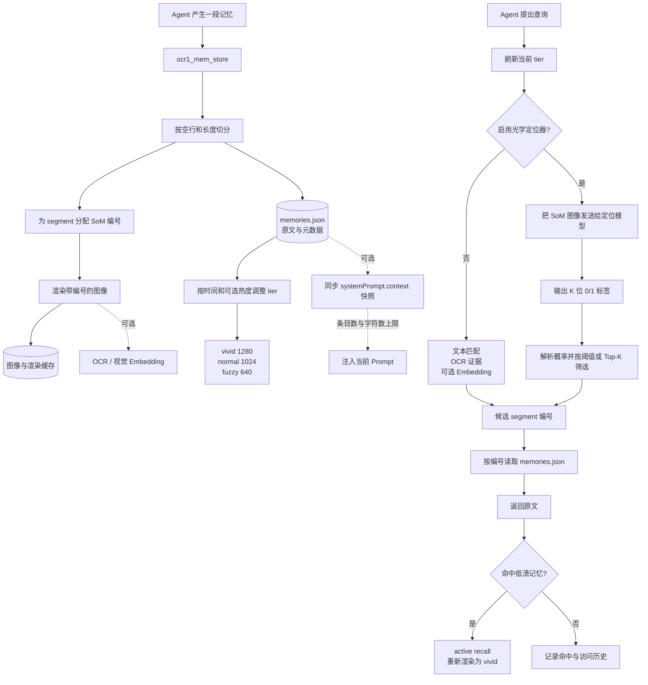

[简体中文] | [English](../docs_en/OPTICAL_MEMORY_WORKFLOW.md)

# 光学记忆插件工作流与当前边界

本文说明 `@dsh-external/dsh-ocr1-memory` 怎样写入、老化和检索记忆，以及当前版本能交付到哪一步。

## 1. 流程概览

插件把每段原文保存为持久化 segment，同时生成带 SoM 编号的图像。图像用于按年龄调整分辨率和辅助定位，最终 Fetch 仍从 `memories.json` 按编号读取原文，所以返回内容保持原样。

```text
原始文本 → 分段并编号 → 渲染 SoM 图像 → 按年龄调整分辨率
查询 → 匹配文本或定位图像中的编号 → 读取 memories.json → 返回原文
```



## 2. 写入与老化

调用 `ocr1_mem_store` 时，插件会按空行和最大长度切分输入，为 segment 分配稳定的顺序编号，渲染 SoM 图像，并把原文、tier、图像路径和命中次数写入 store。OCR 证据与视觉 embedding 由配置决定。

默认图像分为三个 tier。

| Tier | 图像宽度 | 用途 |
|---|---|---|
| `vivid` | 1280 | 新记忆和高精度读取 |
| `normal` | 1024 | 第一阶段老化后的记忆 |
| `fuzzy` | 640 | 长期记忆，视觉成本较低 |

新记忆大约一天后进入 `normal`，七天后进入 `fuzzy`。这些宽度借鉴了 DeepSeek-OCR 的档位命名，图像存储和 tier 管理仍属于插件实现，不能据此推断 DeepEncoder 的内部 token。

启用 `dynamicDecayEnabled` 后，插件会保留有限的访问时间，近期且频繁访问的记忆衰减得更慢。默认值为关闭，升级旧 manifest 时可以维持原有行为。

## 3. 检索

未启用光学定位器时，插件使用文本 token 重叠召回候选，并可加入 OCR 文本、视觉 embedding 相似度和低清命中后的 active recall。`requireOcr: false` 会保留文本路径，`requireOcr: true` 会直接报告 OCR 失败。

启用光学定位器后，插件把当前 tier 的 SoM 图像交给定位模型。模型输出长度为 K 的 `0/1` 序列，插件解析标签和概率，按阈值筛选 segment，没有命中时使用 Top-K。随后插件按编号从 `memories.json` 读取原文并返回，不让模型重新生成记忆内容。这对应 OCR-Memory 论文里的 Locate-and-Transcribe 流程，参见 [论文](https://arxiv.org/html/2604.26622v1)。

命中 `normal` 或 `fuzzy` 图像时，active recall 会把该记忆重新渲染为 `vivid`，记录 `hits`、`lastAccessAt` 和有限的 `accessHistory`，并在短暂宽限期内避免立即降级。

## 4. Prompt context 与维护

开启 `autoInjectContext` 后，插件通过 DSH 的 `systemPrompt.context()` 同步读取 manifest，按命中次数和最近访问时间排序，并受 `contextMaxEntries`、`contextMaxChars` 限制。这个回调不做 OCR、embedding、网络请求或异步检索，manifest 损坏时返回空内容，不阻断 Prompt 组装。

默认 `contextMode: index` 只注入 L1 和光学元数据。`contextMode: snapshot` 才会保留正文快照，因此会占用更多上下文和会话记录。

`memory_maintain` 与自动维护按 namespace single-flight，每次最多刷新 `maintenanceBatchSize` 条光学条目，并返回 `remaining` 与 `complete`。维护、渲染、OCR、embedding 和服务启动都支持 cooperative cancellation。插件卸载时只停止自己启动并记录的进程，外部运行中的 OCR 服务会继续工作。

## 5. 当前交付边界

| 项目 | 当前状态 | 交付限制 |
|---|---|---|
| DeepEncoder 内部 tensor | 未导出逐层隐藏状态和视觉 token | 当前插件通过 llama.cpp/GGUF 的公开 HTTP 接口调用模型，接口不提供内部层 hook |
| 官方内部 embedding | 支持接口级视觉 embedding | `/v1/embeddings` 的向量需要与论文中的内部表示逐项校准，现有后端缺少这部分信息 |
| 论文规模训练 | 已完成小规模 LoRA 定位器流程 | 论文级数据、算力、稳定服务和训练协议尚未具备 |
| 完整 benchmark 复现 | 有 R1 到 R6 和本地隔离测试 | Mind2Web、AppWorld、RULER 需要完整数据、评测环境和论文一致的实验条件 |

这些限制描述当前版本的证据范围。它们不表示相关方向在技术上永远无法实现。

## 6. 后端与资源要求

插件层可以完成 SoM 图像生成、文件保存、segment 定位和原文 Fetch。当前运行路径如下。

```text
插件 → OpenAI 兼容接口 → llama.cpp / GGUF 模型
```

如果要读取 DeepEncoder 内部状态，需要直接加载兼容的模型源码和权重，找到 forward 路径，插入 hook 导出中间 tensor，核对每层 token 的定义，再为插件提供新的接口。这属于独立的模型后端工程。

接口级 embedding 与部分 LoRA 测试已经可以运行。继续校准需要支持模型 hook 的 Transformers 或原生推理路径，并把官方实现和当前后端输出逐项比较。

小规模训练已经验证以下流程可以运行。

```text
SoM 数据 → 图像输入 → 二元监督 → LoRA → 严格解码 → 定位评估
```

这项结果不能替代论文主表。扩大规模还需要论文数据及完整划分、更大的训练和评估预算、长时间推理服务，以及一致的模型版本、量化方式、提示词、标签语法和评测脚本。

## 7. 参考资料

- [DeepSeek-OCR 官方仓库](https://github.com/deepseek-ai/DeepSeek-OCR)
- [DeepSeek-OCR 官方 README](https://github.com/deepseek-ai/DeepSeek-OCR/blob/main/README.md)
- [DeepSeek-OCR 论文](https://arxiv.org/abs/2510.18234)
- [OCR-Memory 论文](https://arxiv.org/abs/2604.26622)
- [论文机制与插件边界清单](2510.18234-paper-vs-plugin-verifiable-concepts.md)
- [llama.cpp Server 文档](https://github.com/ggml-org/llama.cpp/blob/master/tools/server/README.md)
