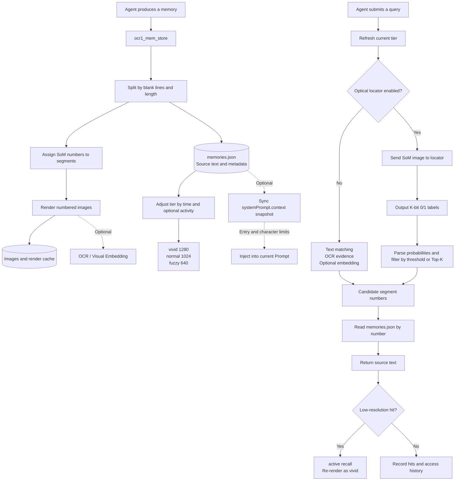

[Chinese](../docs/OPTICAL_MEMORY_WORKFLOW.md) | English

# Optical Memory Plugin Workflow and Current Boundaries

This document describes how `@dsh-external/dsh-ocr1-memory` writes, ages, and retrieves memories, together with the evidence boundary of the current release.

## 1. Workflow overview

The plugin stores each source segment as persistent text and also renders an image with SoM numbers. Images support resolution aging and optional localization. The final Fetch reads the numbered segment from `memories.json`, so the returned content remains verbatim.

```text
Raw text → split and number → render SoM image → adjust resolution by age
Query → match text or locate image numbers → read memories.json → return source text
```



## 2. Write and aging stages

When `ocr1_mem_store` runs, the plugin splits input by blank lines and maximum length, assigns stable sequential numbers, renders SoM images, and stores the source text, tier, image paths, and hit counts. OCR evidence and visual embeddings are controlled by configuration.

The default image tiers are:

| Tier | Image width | Intended use |
|---|---:|---|
| `vivid` | 1280 | New memories and high-precision reading |
| `normal` | 1024 | Memories after the first aging stage |
| `fuzzy` | 640 | Long-term memories at lower visual cost |

New memories remain `vivid` for about one day, enter `normal` after that, and enter `fuzzy` after about seven days. The widths borrow the tier naming used by DeepSeek-OCR. Image storage and tier management are plugin behavior and do not expose DeepEncoder tokens.

With `dynamicDecayEnabled`, the plugin keeps a limited access history so recently and frequently used memories decay more slowly. It is disabled by default to preserve behavior when an old manifest is upgraded.

## 3. Retrieval

Without the optical locator, retrieval uses text-token overlap and can add OCR text, visual-embedding similarity, and active recall after a low-resolution hit. `requireOcr: false` keeps the text path when OCR is unavailable. `requireOcr: true` reports the OCR failure directly.

With the optical locator, the plugin sends the current-tier SoM image to the locator model. The model returns a K-length `0/1` sequence. The plugin parses labels and probabilities, filters segments by threshold, and uses Top-K when there are no threshold hits. It then reads the source text from `memories.json` by segment number. The model does not regenerate the memory. This follows the Locate-and-Transcribe flow in the [OCR-Memory paper](https://arxiv.org/html/2604.26622v1).

When a `normal` or `fuzzy` image is selected, active recall re-renders that memory as `vivid`, records `hits`, `lastAccessAt`, and a limited `accessHistory`, and applies a short grace period before another downgrade.

## 4. Prompt context and maintenance

When `autoInjectContext` is enabled, the plugin registers a synchronous callback through DSH's `systemPrompt.context()`. It reads the local manifest, sorts by hit count and recent access, and respects `contextMaxEntries` and `contextMaxChars`. The callback performs no OCR, embedding, network request, or asynchronous retrieval. A corrupt manifest produces empty context without blocking prompt assembly.

The default `contextMode: index` injects L1 and optical metadata. `contextMode: snapshot` keeps body snapshots as well, which uses more model context and session storage.

`memory_maintain` and automatic maintenance run single-flight per namespace, refresh at most `maintenanceBatchSize` optical entries per run, and return `remaining` and `complete`. Maintenance, rendering, OCR, embedding, and server startup support cooperative cancellation. On disposal, only processes started and recorded by the plugin are stopped; an external OCR server remains running.

## 5. Current delivery boundary

| Item | Current status | Delivery limitation |
|---|---|---|
| DeepEncoder internal tensors | Per-layer hidden states and visual tokens are not exported | The plugin calls llama.cpp/GGUF through a public HTTP interface, which does not expose internal layer hooks |
| Official internal embeddings | Interface-level visual embeddings are supported | Vectors from `/v1/embeddings` still need item-by-item calibration against the paper's internal representation |
| Paper-scale training | A small-scale LoRA locator workflow is complete | The paper's data, compute budget, stable service, and training protocol are not present |
| Complete benchmark reproduction | R1–R6 and local isolated tests are available | Mind2Web, AppWorld, and RULER require their complete data, evaluation environment, and paper-matched conditions |

These points describe the evidence available for the current release. They do not claim that the directions are impossible in a future backend.

## 6. Backend and resource requirements

The plugin layer can generate SoM images, store files, locate segments, and fetch source text. The runtime path is:

```text
Plugin → OpenAI-compatible interface → llama.cpp / GGUF model
```

Reading DeepEncoder state would require a direct model-loading path, compatible source and weights, hooks in the forward pass, verification of each layer's token definition, and a new service interface for the plugin. That is a separate model-backend project.

Interface-level embeddings and some LoRA tests already run. Further calibration needs a Transformers or native inference path with model hooks, followed by item-by-item comparison between the official implementation and the current backend output.

Small-scale training has demonstrated that the following workflow runs:

```text
SoM data → image input → binary supervision → LoRA → strict decoding → localization evaluation
```

This result does not replace the paper's main table. Scaling up also requires the paper's data and splits, a larger training and evaluation budget, a long-running inference service, and consistent model versions, quantization, prompts, label syntax, and evaluation scripts.

## 7. References

- [Official DeepSeek-OCR repository](https://github.com/deepseek-ai/DeepSeek-OCR)
- [Official DeepSeek-OCR README](https://github.com/deepseek-ai/DeepSeek-OCR/blob/main/README.md)
- [DeepSeek-OCR paper](https://arxiv.org/abs/2510.18234)
- [OCR-Memory paper](https://arxiv.org/abs/2604.26622)
- [Paper mapping and plugin boundaries](../docs/2510.18234-paper-vs-plugin-verifiable-concepts.md)
- [llama.cpp Server documentation](https://github.com/ggml-org/llama.cpp/blob/master/tools/server/README.md)
